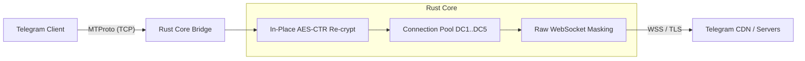

# ⚡ Telegram WebSocket Proxy (Rust + Tauri v2)

[](https://www.rust-lang.org/)
[](https://tauri.app/)
[](https://vuejs.org/)
[](https://tailwindcss.com/)
[](LICENSE)

Высокопроизводительный MTProto-прокси для Telegram с маскировкой трафика под стандартный HTTPS/WSS (WebSocket) поверх TLS. Разработан для обхода блокировок DPI и провайдерских ограничений с минимальной задержкой и околонулевым оверхедом памяти.

---

## ✨ Особенности

- 🚀 **Сверхбыстрое ядро на Rust & Tokio**:
  - **In-place Zero-Copy Re-encryption**: Перешифровка MTProto трафика (AES-CTR) происходит прямо в сетевом буфере без промежуточных аллокаций памяти и очередей каналов.
  - **Оптимизированный WebSocket Handshake**: Вычитывание ответа CDN блоками по 1 КБ с сохранением фреймов вместо побайтового опроса.
  - **Пул горячих соединений (Connection Pool)**: Предварительный прогрев сокетов к датацентрам Telegram (DC2, DC4) и мгновенное автопополнение пула в фоновом режиме.
  - **Корректная остановка**: активные сессии получают окно на сброс буферов и WebSocket-close, лишь затем снимаются — дренаж никогда не зависает.
- 🎨 **Современный GUI (Tauri v2 + Vue 3 + Tailwind CSS v4)**:
  - Глубокая тёмная палитра с неоновыми акцентами и кастомными числовыми степперами.
  - Мониторинг телеметрии в реальном времени: входящий/исходящий трафик, активные сокеты и статус моста.
  - **Диагностика вместо тишины**: uptime моста, счётчик сбоев, текст последней ошибки с копированием для issue, баннер состояния маршрута по каждому DC.
  - Бесшовное автосохранение конфигурации с плавающими уведомлениями.
  - Быстрое копирование прокси-ссылки и открытие прямо в Telegram (`tg://proxy?...`).
- 🛡️ **Обход DPI**:
  - **ECH (Encrypted Client Hello)**: SNI апстрима шифруется — DPI не видит,
    к какому домену идёт соединение (конфиг из DNS через DoH, автоматический
    откат на обычный TLS).
  - Маскировка трафика под легитимный HTTPS трафик к доменам Telegram CDN.
  - Поддержка фрагментации пакетов (Splitter) для обхода эвристик цензуры.
  - Гонка транспортов: параллельное подключение к топ-3 фронтам, побеждает
    первый успешный хендшейк.
- 🌐 **Транспорты**:
  - **WebSocket over TLS** к `kws*.web.telegram.org` (основной путь).
  - **HTTP/3 (QUIC)**: MTProto передаётся телом `POST /mtproto` — подойдёт любой
    HTTP/3-сервер (nginx, Caddy, Cloudflare Worker), свой протокол на релее не нужен.
  - **QUIC с кастомным ALPN** для собственных релеев.
  - Прозрачный каскад: WS → QUIC/H3 → Cloudflare → прямой TCP.
- 🔒 **Валидация конфига**: нерабочие настройки (плохой секрет, порт `0`, битый
  релей, не-IP в DC-redirect) отклоняются до запуска моста с внятной ошибкой,
  а не превращаются в «прокси работает, но ничего не грузится».
- 📱 **Android**:
  - Сборка APK (arm64), safe-area, мобильная навигация.
  - `tg://proxy?…` открывается напрямую в установленном Telegram.
  - Плитка «Прокси» в Quick Settings: старт/стоп моста из шторки, без
    открытия приложения.
- 📦 **Системная интеграция**:
  - Работа в системном трее, автозапуск при входе в систему (сразу в трей, без окна), кастомный заголовок окна.

---

## 🛠 Архитектура



---

## 📥 Установка и запуск

### Готовые релизы
Перейдите на страницу **[Releases](https://github.com/rxzsu/tg-ws-rust/releases)** и скачайте сборку для вашей ОС:
- **Windows**: `.msi` инсталлятор или `.exe`
- **Linux**: `.AppImage` или `.deb`
- **Android**: `.apk` (arm64) — прикладывается к релизу отдельным артефактом

### Сборка из исходников

Требования:
- [Bun](https://bun.sh/) (рекомендуется) или Node.js 20+
- [Rust](https://rustup.rs/) (версия 1.85+ с поддержкой редакции 2024)

1. Клонируйте репозиторий:
   ```bash
   git clone https://github.com/rxzsu/tg-ws-rust.git
   cd tg-ws-rust
   ```

2. Установите зависимости фронтенда:
   ```bash
   bun install
   ```

3. Запустите в режиме разработки:
   ```bash
   bun run tauri dev
   ```

4. Соберите релизный бинарник:
   ```bash
   bun run tauri build
   ```

### Android

Нужны Android SDK (platform 34+), NDK и JDK 17+; переменная `NDK_HOME`
(или `ANDROID_NDK_HOME`) должна указывать на NDK.

```bash
bunx tauri android init          # один раз, создаёт src-tauri/gen/android
bunx tauri android build --apk --target aarch64
```

APK появится в `src-tauri/gen/android/app/build/outputs/apk/`.
Готовая CI-сборка — workflow `.github/workflows/android.yml`.

**Фоновая работа:** при запуске моста приложение поднимает foreground service
с постоянным уведомлением «Мост активен», чтобы Android не замораживал процесс
сразу после ухода в фон. Это не абсолютная гарантия: агрессивная экономия
батареи или свайп приложения из списка задач всё ещё могут остановить процесс.
Разрешение на уведомления (Android 13+) сервис не требует, но без него
уведомление может быть скрыто системой.

**Подпись APK:** локально — `.\scripts\build-android.ps1 -Release -GenerateKey`
(ключ хранится в `%USERPROFILE%\.tgwsproxy\`, не в репозитории). CI собирает
подписанный APK, если заданы секреты `ANDROID_KEYSTORE_BASE64`,
`ANDROID_KEYSTORE_PASSWORD`, `ANDROID_KEY_ALIAS`, `ANDROID_KEY_PASSWORD`. Без них
артефакт будет unsigned — Android откажется его устанавливать. Подробности —
`docs/RELEASING.md`.

---

## ⚙️ Настройки

| Параметр | По умолчанию | Описание |
| :--- | :--- | :--- |
| **Порт** | `1443` | Локальный порт для подключения Telegram клиента |
| **Секрет** | генерируется | Секретный ключ MTProto прокси |
| **Транспорт** | `auto` | `auto` / `ws` / `quic` / `h3` — приоритет апстрима |
| **Релеи** | — | `host:port` для QUIC/H3 транспортов |
| **Пул соединений** | `4` | Количество готовых предварительно открытых WebSocket сессий (`0` — пул выключен) |
| **Размер буфера** | `262144` | Размер буфера передачи данных, 4 КиБ–1 МиБ (в байтах) |
| **Keep-alive пула** | `15` | Интервал WS-ping для сокетов пула, сек; `0` — выключено |
| **Сплиттер** | `Вкл` | Случайная фрагментация первого пакета (до 96 байт) для обхода DPI |
| **Автозапуск** | `Выкл` | Старт при входе в систему; окно остаётся в трее, прокси работает в фоне |
| **Cloudflare-домены** | — | Домены на Cloudflare, проксирующие к Telegram (запасной канал) |
| **Встроенные CF-домены** | `Вкл` | Пул сторонних Cloudflare-доменов и его обновление с GitHub |
| **Worker-домены** | — | Домены Cloudflare Worker вида `apiws?dst=<DC-IP>&dc=N&media=1` |

---

## 🔐 Приватность и сторонние домены

Для обхода блокировок приложение может использовать **встроенный пул чужих
Cloudflare-доменов** (список захардкожен, раз в час обновляется из GitHub) и
Cloudflare Worker-релеи. Трафик в этом режиме идёт через инфраструктуру, которую
вы не контролируете, — как и любой публичный релей.

- Отключите **«Встроенные сторонние CF-домены»** в настройках, если нужен только
  ваш собственный домен/воркер: после этого каскад состоит из WS → ваши
  QUIC/H3-релеи → ваш Cloudflare-домен → прямой TCP.
- При отключении флаг сохраняется в `config.json`
  (`use_builtin_cf_domains`), фоновая загрузка списка с GitHub тоже
  прекращается.

---

## ⚠️ Известное ограничение: DC1 / DC3 / DC5

Telegram отдаёт WebSocket-фронт `/apiws` **только для DC2 и DC4**. Для остальных
дата-центров (DC1, DC3, DC5) общий фронт отвечает `302 → core.telegram.org`, а
собственные IP этих DC на большинстве сетей режутся DPI по TCP.

**Что это значит на практике:** если аккаунт Telegram зарегистрирован (или его
файлы и медиа лежат) в DC1/DC3/DC5, через этот прокси эти файлы не загрузятся:
маршрута просто нет. Дашборд покажет это прямо — красный баннер с указанием DC
и причиной, а не тихо висящий прогресс.

**Кому подходит как есть:** аккаунты в DC2/DC4 — там работает весь каскад
WS → QUIC/H3 → Cloudflare → TCP.

**Как обходится ограничение:** добавить релей, у которого есть выход на нужный
DC — домен на Cloudflare (раздел «Cloudflare-домены»), Cloudflare Worker
(`apiws?dst=<DC-IP>&dc=N&media=1`) или свой QUIC/HTTP3-релей. Либо другой канал
связи (VPN) для трафика в этот DC.

---

## 🔄 Обновления

Проверка обновлений обращается к GitHub Releases и сравнивает версии численно;
если тег новее, на дашборде появляется баннер со ссылкой на релиз. Автоматической
установки пока нет — для неё нужны ключи подписи и `.sig`-артефакты
(`tauri-plugin-updater`). Как включить — см. `docs/RELEASING.md`.

---

## 📄 Лицензия

Проект распространяется под лицензией [MIT](LICENSE).
